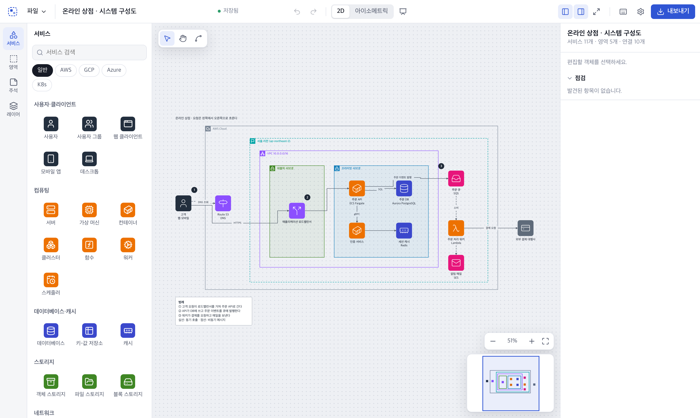

<div align="center">

# Structlet

**시스템 구성도를 만들고 다듬는 로컬 우선 웹 편집기**

서비스 노드를 놓고, Cloud/Region/VPC/Subnet 영역을 중첩하고, 직교 연결선을 이어 SVG·PNG로 내보낸다.<br>
서버·계정·외부 AI 호출 없이 동작한다.

[](https://github.com/sejoung/Structlet/actions/workflows/ci.yml)
[](https://github.com/sejoung/Structlet/actions/workflows/pages.yml)
[](LICENSE)
[](.nvmrc)
<br>
[](tsconfig.json)
[](package.json)
[](vite.config.ts)
[](tests/unit)
[](tests/e2e)

[English](README.md) · **한국어**

[**바로 써 보기**](https://sejoung.github.io/Structlet/) · [오프라인 단일 파일](https://sejoung.github.io/Structlet/structlet.html) · [설계 기록](docs/adr/README.md)



</div>

## 특징

- 🧩 **서비스와 중첩 영역** — 일반·AWS·Google Cloud·Azure·Kubernetes 카탈로그, Cloud ▸ Region ▸ VPC ▸ Subnet 계층
- 🔀 **직교 연결선** — 장애물을 피하는 A* 자동 경로, 고친 선만 수동 꺾임점으로 저장
- 📥 **가져오기와 자동 배치** — 좌표 없는 JSON 초안, `docker-compose.yml`, Kubernetes 매니페스트, `terraform show -json`(AWS·Google Cloud·Azure)
- 🎨 **공식 아이콘 팩** — 사용자가 직접 받은 제공자 아이콘(zip 또는 폴더)을 불러와 사용
- 🧊 **아이소메트릭 보기와 내보내기** — 캔버스와 같은 렌더러로 SVG·PNG 출력
- 🔎 **구성 점검** — 퍼블릭 서브넷의 데이터 저장소, 클라이언트→DB 직접 연결, 연결 없는 서비스, 빈 영역
- 💾 **로컬 우선** — 브라우저 자동 저장, `.structlet` 파일 저장, HTML 한 파일(`file://`)로도 동작
- ☁️ **선택적 Google Drive 동기화** — 웹에 배포하면 기기·탭 사이 3방향 병합
- 🌗 **라이트/다크 테마, 한국어/영어 화면**, 키보드 탐색, 터치 지원

## 실행

Node.js 20 이상(개발 확인: Node 24, npm 11).

```bash
npm install
npm run dev          # http://127.0.0.1:5183
```

처음 열면 빈 캔버스다. **파일 → 샘플**(또는 가운데의 **샘플 열기**)을 누르면 검증용 구성도(사용자 → DNS → 로드밸런서 → API → DB/캐시/큐 → 워커 → 결제·메일, VPC 안 두 서브넷, 노드 11개·영역 5개·연결 10개)가 열린다. 원본은 [`samples/three-tier.structlet`](samples/three-tier.structlet)이다.

| 명령 | 내용 |
| --- | --- |
| `npm run dev` | 개발 서버 (`127.0.0.1:5183`). Drive는 동작하고, 사용 통계는 보내지 않는다 |
| `npm run build` | 타입 검사 + 정적 빌드(`dist/`). 상대 경로라 도메인 루트든 하위 경로든 아무 정적 호스팅에 올리면 된다 |
| `npm run build:single` | HTML 한 파일(`dist-single/structlet.html`, 약 0.5MB). 더블클릭(`file://`)으로 열린다 |
| `npm run preview` | 빌드 결과 미리보기 (`127.0.0.1:5184`, CSP 포함) |
| `npm test` | 단위 테스트 (Vitest, `tests/unit`) |
| `npm run e2e` | 단일 파일 빌드 후 E2E (Playwright, `tests/e2e`). 프로덕션 빌드 두 벌(기본, 테스트 측정 ID)을 `vite preview`로 띄워 검사하고 Google은 흉내 낸다. 처음 한 번 `npx playwright install chromium` |
| `npm run check` | 타입 검사 → 단위 → 웹 빌드 → 단일 파일 빌드 (CI의 checks job) |
| `npm run verify` | `check` + E2E 전부 (Pages 배포 전 검사) |

**CI와 배포** — push와 PR마다 GitHub Actions의 **CI**가 검사와 E2E를 돌린다. GitHub Pages 배포는 Actions 탭의 **Pages → Run workflow** 버튼으로 수동으로 하고, 모든 검사를 통과해야 배포된다. 처음 설정(Pages 소스, 저장소 변수, Google origin 등록)은 [docs/ci.md](docs/ci.md)에 있다. 배포한 사이트의 `/structlet.html`은 오프라인용 단일 파일이다.

**선택 기능** — Google Drive와 사용 통계는 `.env.example`을 `.env.local`로 복사해 공개 설정 값을 넣으면 켜진다. 값이 없으면 그 기능 없이 빌드된다. Google Cloud·GA4 설정과 등록할 origin은 [docs/google-drive.md](docs/google-drive.md)에 있다.

## 사용법

화면은 네 부분이다.

- **위 막대** — 왼쪽에 파일 메뉴·제목·저장 상태, 가운데에 실행 취소와 2D/아이소메트릭, 오른쪽에 단축키·설정(⚙)·**내보내기**가 있다.
- **왼쪽** — 아이콘 레일로 **서비스 / 영역 / 주석 / 레이어** 패널을 바꾼다.
- **오른쪽 인스펙터** — 선택한 객체의 속성이 나온다.
- **캔버스** — 왼쪽 위에 도구 막대, 오른쪽 아래에 확대 막대와 미니맵이 떠 있다.

<details>
<summary><b>패널</b></summary>

패널은 숨길 수 있다. 위 막대 오른쪽에 **[왼쪽 패널] [오른쪽 패널] [양쪽]** 토글 세 개가 늘 같은 자리에 있다.

- 패널이 보이는 동안 해당 버튼이 눌린 상태로 표시된다.
- `⌘\`는 양쪽을 한 번에 토글한다. 레일에서 열린 탭을 다시 눌러도 왼쪽 패널이 접힌다.
- 숨긴 상태는 이 브라우저에 기억된다. 창이 1100px보다 좁아지면 오른쪽 패널이 자동으로 접힌다.
- 패널을 열고 닫아도 구성도의 화면 중심은 그대로다.

</details>

<details>
<summary><b>도구와 보기 모드</b></summary>

- **선택**(`V`, 기본) — 누르면 선택, 끌면 이동한다.
- **손**(`H`) — 어디를 끌어도 화면만 움직이고 선택·이동·편집은 일어나지 않는다. 확대는 그대로 된다. Space를 누르는 동안은 어느 도구에서든 임시 손이다.
- **연결**(`C`) — 손잡이를 집지 않아도 상자에서 상자로 끌기만 하면 연결된다. 빈 곳을 끌면 화면이 움직이고, Esc로 선택 도구로 돌아간다.

**보기 모드**(`⌘.` 또는 위 막대의 화면 단추)는 패널, 도구 막대, 편집 손잡이를 숨기고 손 도구로 바꾼 뒤 화면에 맞춘다. 회의에서 설명할 때 쓴다. Esc나 **보기 모드 끝내기**로 나온다.

</details>

<details>
<summary><b>편집</b></summary>

- **서비스 추가** — **서비스** 패널에서 검색(한국어·영어)하거나, 제공자(일반·AWS·GCP·Azure·Kubernetes)를 골라 역할별 격자에서 찾는다. 클릭하거나 캔버스로 끌어 놓는다. 영역 안에 놓으면 그 영역의 자식이 된다. 최근 사용한 서비스가 맨 위에 나온다.
- **레이어** — **레이어** 패널은 Cloud ▸ Region ▸ VPC ▸ Subnet ▸ 서비스 계층을 트리로 보여준다. 들여쓰기 선은 각 영역의 색이다.
  - 행을 누르면 캔버스에서도 선택된다.
  - 더블클릭이나 Enter로 이름을 바꾼다.
  - 행을 다른 영역 위로 끌면 그 안으로 옮겨진다. 맨 위 **캔버스**로 끌면 영역 밖으로 나온다.
  - 화살표 키로 이동·펼치기·접기를 한다.
- **아이콘 팩** — **설정(⚙) → 아이콘 팩**에서 제공자 공식 아이콘(zip 또는 압축을 푼 폴더)을 불러온다. Structlet은 제공자 아이콘을 포함하지 않는다. 받는 곳: [AWS](https://aws.amazon.com/architecture/icons/), [Google Cloud](https://cloud.google.com/icons), [Azure](https://learn.microsoft.com/azure/architecture/icons/), Kubernetes(kubernetes/community 저장소). 아이콘은 이 브라우저에만 저장되고 화면·SVG·PNG에 쓰인다. `.structlet`에는 서비스 ID만 남아 팩이 없는 사람에게는 일반 기호로 보인다. 팩은 켜고 끄거나 지울 수 있다.
- **영역** — **영역** 패널에서 고른다. 상자를 선택한 상태면 선택한 것을 감싸는 영역을 만든다. 영역을 끌면 안의 모든 것이 따라오고, 노드·영역을 다른 영역 위로 끌어 놓으면 부모가 바뀐다. 모서리 손잡이로 크기를 바꾼다.
- **연결** — 노드에 마우스를 올리면 나타나는 면 손잡이를 다른 객체로 끈다. 두 상자를 선택하고 속성 패널의 **연결 →**도 된다.
- **선 편집** — 선을 선택하고 선분 손잡이(또는 선 자체)를 끌면 경로가 수동이 된다. 끝점 손잡이를 끌어 다른 객체·면에 다시 붙이거나 빈 곳에 놓아 자유 끝점으로 만든다. 속성 패널에서 라벨, 점선, 화살표, 직교/직선, 시작·끝 면, **경로 초기화**.
- **이름 바꾸기** — 더블클릭 또는 Enter/F2. Shift+Enter는 줄바꿈.
- **정렬·간격·자동 배치** — 여러 개를 선택하면 속성 패널에 정렬 6종, 간격 맞춤, 자동 배치(왼→오, 위→아래, 격자)가 나온다. 영역을 선택하면 "안쪽 자동 배치". 고정한 상자와 수동 경로는 그대로 둔다. 끌 때는 다른 객체의 가장자리·가운데에 맞춰지고, 그 외에는 8px 격자에 붙는다(Alt를 누르면 끔).
- **노드 모양** — 인스펙터의 **모양**에서 아이콘형/상자형, 크기 S·M·L을 고른다.
- **주석** — **주석** 패널에서 텍스트, 흐름 번호, 범례를 넣는다. 범례는 구성도에서 쓰는 역할 색과 선 모양으로 자동으로 채워지고 "다시 만들기"로 갱신한다. 주석을 객체에 붙이면 함께 움직인다.
- **가져오기** — **파일 → 가져오기**로 초안 JSON([형식](docs/draft-format.md), [예시](samples/draft-example.json)), `docker-compose.yml`, Kubernetes 매니페스트(`kubectl get -o yaml|json`, `helm template`), `terraform show -json` 결과를 현재 구성도에 합친다. 기존 객체의 ID·위치·고정은 유지되고 새 객체만 배치된다. 오류가 있으면 아무것도 바뀌지 않는다. 한 번의 실행 취소로 되돌린다. 같은 내용을 붙여넣어도 된다.
- **복사·붙여넣기** — ⌘C/⌘X/⌘V. 영역은 내용과 내부 연결선까지 복사되고, 선택한 영역 안에 붙는다.
- **점검** — 아무것도 선택하지 않으면 인스펙터에 점검 결과(퍼블릭 서브넷의 데이터 저장소, 클라이언트→DB 직접 연결, 모르는 서비스, 연결 없는 서비스, 빈 영역)가 나오고, 누르면 해당 객체를 선택한다.

</details>

<details>
<summary><b>Google Drive와 사용 통계</b></summary>

- **Google Drive**(웹 배포·설정한 빌드에서) — 위 막대의 Drive 버튼이나 **파일 → Google Drive**에서 연결하고, 폴더를 골라 저장한다.
  - 이후 편집은 2초 뒤(계속 편집해도 최대 10초마다) 자동 저장되고, ⌘S는 Drive에 바로 저장한다.
  - 다른 기기·탭에서 바뀐 부분은 자동으로 합쳐지고, 같은 곳을 다르게 고쳤을 때만 남길 쪽을 고른다.
  - **Drive에서 열기**, **다른 폴더에 사본 저장**, **동기화 중지**, **연결 해제**가 있다. 토큰은 메모리에만 두고, HTML 한 파일(`file://`)에서는 꺼진다([설정과 동작](docs/google-drive.md)).
- **사용 통계**(측정 ID를 넣은 빌드에서) — 처음 방문 때 배너로 묻고, 허용해야만 보낸다. 기능 이름과 오류 이름만 보내고 구성도 내용은 보내지 않는다. **설정(⚙) → 사용 통계 보내기**에서 바꾼다.

</details>

<details>
<summary><b>보기·테마·키보드</b></summary>

- **보기** — 스크롤로 이동, ⌘/Ctrl+스크롤로 확대, Space+끌기 또는 가운데 버튼으로 이동, ⌘0 화면 맞춤. 오른쪽 아래 확대 막대(퍼센트를 누르면 100%)와 미니맵이 있다. 터치는 한 손가락 이동·두 손가락 확대. **아이소메트릭** 보기는 읽기 전용이고, 이 보기에서 SVG·PNG를 내보내면 아이소메트릭 그림이 된다. 테마(시스템/라이트/다크)와 언어는 **설정(⚙)**에서 바꾼다(내보내기는 항상 라이트).
- **키보드** — 캔버스에서 Tab/Shift+Tab으로 객체 사이를 옮기고, 선택한 객체는 화면 낭독기가 읽는다. 메뉴는 Enter로 열고 화살표로 고르며 Esc로 닫는다. 위 막대의 ⌨ 단추가 단축키 목록을 보여준다.

</details>

### 단축키

| 단축키 | 동작 |
| --- | --- |
| ⌘/Ctrl+Z, ⇧⌘Z / Ctrl+Y | 실행 취소, 다시 실행 |
| ⌘S, ⇧⌘S, ⌘O | 저장, 다른 이름으로 저장, 열기 |
| ⌘C, ⌘X, ⌘V | 복사, 잘라내기, 붙여넣기 |
| ⌘D, Delete/Backspace | 복제, 삭제 |
| ⌘A, Esc | 전체 선택, 선택 해제 |
| 화살표, ⇧+화살표 | 1px, 8px 이동 |
| Alt+영역 끌기 | 영역 위에서 범위 선택 |
| V, H, C | 선택, 손, 연결 도구 |
| ⌘\ | 패널 숨기기·보이기 |
| ⌘. | 보기 모드 |

### 저장

변경은 이 브라우저의 `localStorage`에 자동 저장되고 새로 고침해도 남는다. 파일로 보관하려면 **저장**한다. Chrome·Edge처럼 File System Access API가 있는 브라우저에서는 연 파일에 바로 덮어쓰고, 없는 브라우저에서는 다운로드한다.

## 구조

```text
src/
  domain/       문서·노드·영역·연결선·주석 모델, 계층, 명령, 패치, 검증   (의존 없음)
  application/  편집 세션(미리보기·undo/redo·선택), 편집 유스케이스        (domain)
  engine/       월드 좌표, 장면, 포트·라우팅, 자동 배치, 스냅·정렬, 히트, SVG·아이소메트릭 마크업  (domain)
  adapters/     .structlet 형식, 초안·compose·Kubernetes·Terraform 가져오기, 자동 저장, 파일 입출력, SVG/PNG,
                제공자별 카탈로그·아이콘 팩·범례·점검
  components/   위 막대, 사이드바(서비스·영역·주석·레이어), 캔버스, 인스펙터, 공통 UI(ui/)
  app/          조립, 자동 저장, 단축키
  i18n/         한국어·영어 메시지
tests/
  unit/         domain · application · engine · adapters · architecture (Vitest)
  e2e/          실제 앱을 띄워 검증 (Playwright)
samples/        샘플 .structlet, 초안 JSON 예시
docs/draft-format.md  초안 JSON 형식
docs/adr/       설계 기록. stormlet-reference/ 에 참고한 Stormlet ADR 원본
```

계층 규칙은 `tests/unit/architecture/layers.test.ts`가 강제한다. 결정 배경은 [docs/adr](docs/adr/README.md)에 있다.

- **모델** — 노드·영역은 명시적 `parentId`와 부모 기준 로컬 좌표로 저장한다. 순환은 거부한다([ADR 0002](docs/adr/0002-service-nodes-and-explicit-areas.md)).
- **연결선** — 자동 경로는 저장하지 않고 매번 계산하며(장애물 회피 A*), 사용자가 고친 경로만 꺾임점으로 저장한다([ADR 0003](docs/adr/0003-edge-routing-and-manual-waypoints.md)).
- **파일** — 버전 있는 JSON, 열 때 크기·유한 좌표·참조·순환·버전을 검증한다. 실패하면 열린 문서를 바꾸지 않는다([ADR 0004](docs/adr/0004-structlet-file-format.md)).
- **렌더링** — 화면과 내보내기는 같은 장면과 같은 SVG 렌더러를 쓴다([ADR 0005](docs/adr/0005-one-renderer-for-canvas-and-export.md)).
- **카탈로그와 아이콘** — 서비스 정의(카탈로그)와 모양(아이콘 팩)을 나눈다. 공식 아이콘은 사용자가 불러온다([ADR 0006](docs/adr/0006-service-catalog-and-icons.md), [ADR 0013](docs/adr/0013-icon-packs.md)).
- **배포** — 정적 사이트(CSP 포함) 또는 HTML 한 파일이다([ADR 0014](docs/adr/0014-static-deployment.md)).
- **동기화와 통계** — Drive 동기화는 세션을 감싸 3방향 병합하고, 병합 결과는 계층 규칙을 지킨다([ADR 0016](docs/adr/0016-google-drive-sync.md)). 사용 통계는 동의 후 목록에 있는 이벤트만 보낸다([ADR 0017](docs/adr/0017-usage-statistics.md)). 둘 다 같은 저작자의 Stormlet(MIT)에서 옮겼다.

## 검증 현황

<details>
<summary><b>단위 125개</b> (<code>tests/unit</code>)</summary>

- **domain** — 계층·로컬 좌표·자식 동반 이동, 부모 변경·순환 거부, 패치 undo(인접 삭제 순서 포함), 조각 복사·붙여넣기, 문서 차이
- **domain** — 3방향 병합(필드·위치 묶음·삭제 충돌·계층 복구·순환)
- **application** — 세션의 미리보기·한 번의 커밋·입력 합치기; Drive 동기화(일정·병합·충돌·재시도·일시 중지·계정·정리)
- **engine**
  - 경로: 기본 모양, 장애물 우회, 수동 경로 재현과 이동 후 유지, 수동 구간 우회, 붐비는 면 피하기, 포트 분산, 라벨 겹침 회피
  - 배치: 층 순서, 교차 줄이기, 선택 배치의 고정 유지
  - 렌더링: 상자 노드, 범례 견본, 다크 테마, 아이소메트릭
  - 성능: 노드 400·선 300
- **adapters**
  - 파일: 왕복, 12가지 잘못된 입력 거부
  - 초안: 빈 문서 배치, 부분 수정(ID·위치·고정 유지), 오류 4종 거부, 문서화된 예시
  - compose, Kubernetes, Terraform(AWS·Azure·GCP) 변환
  - 아이콘 팩: 제공자별 짝짓기, 자동 감지, zip, 한도, 렌더링
  - SVG가 캔버스와 같은 경로·라벨인지, 점검, 범례, 같은 파일에 저장
  - Drive: REST 계약·이름 번호·유실 응답·실패 대응, 토큰·탭 공유·설정
  - 사용 통계: 동의 전 무전송, 목록 이벤트만, 상한, 거부 시 쿠키 삭제; CSP 구성
- **architecture** — 계층 규칙

</details>

<details>
<summary><b>E2E 35개</b> (<code>tests/e2e</code>, 프로덕션 빌드)</summary>

- **기본 흐름** — 노드 두 개 → 연결 → 저장 → 열기 → 새로 고침 → SVG(화면과 같은 경로), PNG, 잘못된 파일 거부
- **영역** — VPC 끌기 후 한 번의 undo, 다른 영역으로 끌어 넣기, 감싸기
- **연결선** — 수동 경로 유지·초기화, 끝점 재부착
- **편집** — 한국어 긴 이름 편집, 자동 배치 undo, 복사·붙여넣기
- **가져오기** — 초안 부분 수정과 오류 거부, compose
- **아이콘 팩** — AWS zip 팩(캔버스·영역·팔레트·내보내기·새로 고침 후 유지·끄기), Kubernetes 아이콘 폴더 + 매니페스트 가져오기
- **보기** — 아이소메트릭 보기·내보내기, 다크 테마·상자 노드·범례·점검·미니맵·Tab 이동, 터치 이동·확대
- **배포** — `file://`로 연 단일 HTML(가져오기, 내보내기, 자동 저장, Drive 비활성), 프로덕션 빌드의 CSP 위반 없음
- **Drive**(흉내 낸 Google) — 연결·폴더 저장·자동 저장·⌘S, 새로 고침 후 재연결(빈 문서를 쓰지 않음), 원격 변경 병합과 충돌 선택, 열기·동기화 중지·연결 해제
- **사용 통계** — 동의 전 무전송, 허용 후 이벤트·주소 정리, 끄기, 거부
- **패널·도구** — 패널 접기와 기억, `⌘\`, 패널 토글 세 개(위치 고정, 캔버스가 창 끝까지, 중심 유지); 손 도구(화면만 이동, 문서 불변, 편집 없음); 연결 도구(연속 연결, 빈 곳 이동, Esc); 보기 모드
- **화면 구성** — 레이어 트리(계층 표시, 캔버스와 선택 연동, 키보드, 이름 바꾸기, 끌어서 부모 바꾸기와 undo, 접기), 최근 사용, 단축키 창, 메뉴 키보드 조작

</details>

## 범위

시작 요구사항의 첫 버전 1–7과 구현 순서 1–5를 모두 구현했다. 후속 검토 항목 중 로컬에서 가능한 것도 넣었다: 아이소메트릭 보기, Terraform/Compose/Kubernetes 가져오기, 보안 성격의 구성 점검. 추가로 다음을 넣었다: 아이콘 팩, 클립보드, 같은 파일에 저장, 미니맵, 다크 모드, 터치, 키보드 탐색, 상자형 노드, 범례 자동 생성, 단일 HTML 배포, Google Drive 동기화, 사용 통계.

> [!IMPORTANT]
> **직접 확인할 것** — Drive의 실제 OAuth 동의·Picker·권한 철회와 GA 실시간 보고서는 자동 테스트로 확인할 수 없다. Google Cloud에 Structlet origin을 등록한 뒤 [확인 목록](docs/google-drive.md#확인할-것-실제-계정)대로 확인한다.

<details>
<summary><b>하지 않은 것과 이유</b></summary>

| 항목 | 이유 |
| --- | --- |
| 공식 아이콘 포함 | 제공자 조건상 번들링은 별도 허가가 권장된다. 사용자가 직접 받은 팩을 불러오는 방식으로 대신했다([ADR 0013](docs/adr/0013-icon-packs.md)). 유료로 제공하기 전에는 조건을 다시 확인한다 |
| 클라우드 계정 연동, 비용 분석 | 자격 증명·외부 API·가격 데이터가 필요하다. 외부 호출 없이 동작한다는 로컬 우선 원칙과 맞지 않는다. 계정 상태는 `terraform show -json`이나 `kubectl get -o yaml`로 가져올 수 있다 |
| 실시간 협업 | 동기화 서버나 P2P 계층이 필요하다. Drive 동기화는 저장할 때 합치는 방식이고 실시간 공동 편집은 아니다 |
| 이름·도메인·상표 확인 | 법률 검토 사항이라 코드로 처리할 수 없다 |
| 선 묶기 | 포트 분산·차선 분리로 선마다 출발·도착을 구분하는 방식을 택했다([ADR 0003](docs/adr/0003-edge-routing-and-manual-waypoints.md)) |
| HCL 직접 파싱 | Terraform은 `terraform show -json`을 쓴다 |

</details>

## 상표

AWS, Amazon Web Services 및 AWS 서비스 이름은 Amazon.com, Inc. 또는 계열사의 상표다. Google Cloud는 Google LLC의 상표다. Microsoft Azure는 Microsoft 그룹의 상표다. Kubernetes는 The Linux Foundation의 등록 상표다. Structlet은 이들과 제휴하거나 보증받지 않았다. 서비스 이름은 구성 요소를 가리키는 글자로만 쓴다.

## 라이선스

[Apache-2.0](LICENSE). 기호는 Lucide(ISC, 일부 Feather MIT), YAML 파서는 yaml(ISC), zip 읽기는 fflate(MIT), Drive·통계 코드는 Stormlet(MIT)에서 옮겼다 — [THIRD_PARTY_NOTICES.md](THIRD_PARTY_NOTICES.md).
