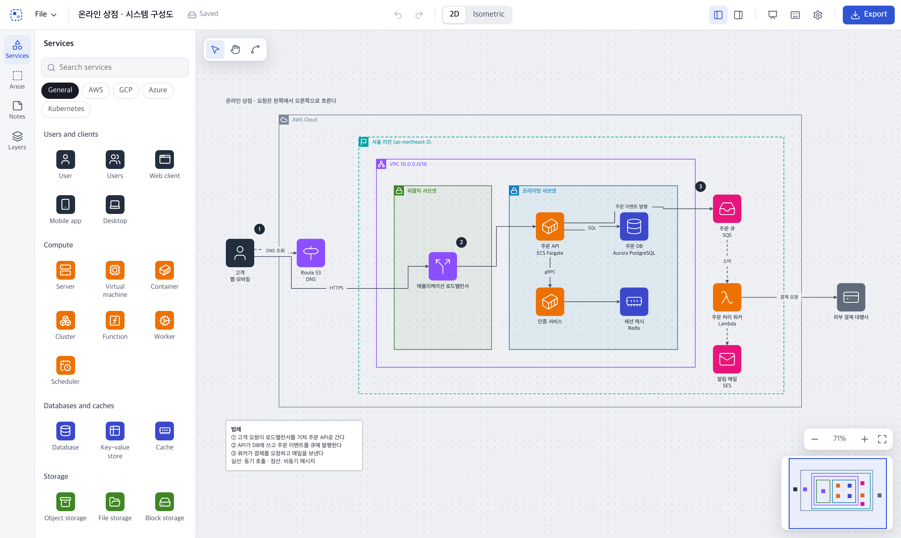

<div align="center">

# Structlet

**A local-first web editor for system architecture diagrams.**

Place services, nest Cloud / Region / VPC / Subnet areas, wire them with orthogonal connectors,<br>
and export to SVG or PNG — no server, no account, no external AI calls.

[](https://github.com/sejoung/Structlet/actions/workflows/ci.yml)
[](https://github.com/sejoung/Structlet/actions/workflows/pages.yml)
[](LICENSE)
[](package.json)
<br>
[](tsconfig.json)
[](package.json)
[](vite.config.ts)
<br>
[](tests/unit)
[](tests/e2e)
[](.oxlintrc.json)
[](.dependency-cruiser.cjs)

**English** · [한국어](README.ko.md)

[**Live demo**](https://sejoung.github.io/Structlet/) · [Offline single file](https://sejoung.github.io/Structlet/structlet.html) · [Design records](docs/adr/README.md)



</div>

## Features

- 🧩 **Services and nested areas** — General, AWS, Google Cloud, Azure, Kubernetes and NVIDIA catalogs; areas nest as Cloud ▸ Region ▸ VPC ▸ Subnet.
- 🔀 **Orthogonal connectors** — obstacle-avoiding A* routing, with manual waypoints only where you edit a path.
- 📥 **Import and auto-layout** — coordinate-free JSON drafts, `docker-compose.yml`, Kubernetes manifests and `terraform show -json` (AWS · Google Cloud · Azure).
- 🎨 **Official icon packs** — load the provider icon packs you downloaded yourself (zip or folder).
- 🧊 **Isometric view and export** — SVG and PNG come from the same renderer as the canvas.
- 🔎 **Built-in checks** — data stores in public subnets, direct client → DB connections, orphan services, empty areas.
- 💾 **Local-first** — autosaves to the browser, saves `.structlet` files, and runs as a single HTML file (`file://`).
- ☁️ **Optional Google Drive sync** — three-way merge across devices and tabs when deployed to the web.
- 🌗 **Light / dark themes, Korean / English UI**, keyboard navigation, touch support.

## Getting started

Requires Node.js 22 or later (CI and development use Node 24 from [`.nvmrc`](.nvmrc), npm 11).

```bash
npm install
npm run dev          # http://127.0.0.1:5183
```

The editor opens on an empty canvas. Open **Help (?)** in the top bar to open the full user guide in a new tab, with a quick guide, a screenshot of the editor, and links to official icon packs. Choose **Download sample (.structlet)**, then drop the downloaded file onto the canvas or use **File → Open**. The source is [`samples/three-tier.structlet`](samples/three-tier.structlet). Help also offers [distributed GPU training](samples/gpu-training.structlet) and [MIG inference](samples/mig-inference.structlet) samples. On a selected connection, choose **Link preset** for NVLink, InfiniBand or Ethernet / RoCE.

| Command | What it does |
| --- | --- |
| `npm run dev` | Dev server (`127.0.0.1:5183`). Drive works; usage statistics are not sent |
| `npm run typecheck` | Type check only (`tsc --noEmit`) |
| `npm run build` | Type check + static build (`dist/`). Uses relative paths, so any static host works, at the domain root or a sub-path |
| `npm run build:single` | One HTML file (`dist-single/structlet.html`, about 1.3 MB) that opens by double-click (`file://`) |
| `npm run preview` | Preview the build (`127.0.0.1:5184`, with CSP) |
| `npm test` | Unit tests (Vitest, `tests/unit`); `npm run test:watch` reruns them on change |
| `npm run e2e` | Builds the single file, then runs E2E (Playwright, `tests/e2e`) against two production builds served by `vite preview`, with Google mocked. Run `npx playwright install chromium` once first |
| `npm run lint` | oxlint: at most 400 lines per file, no `console` in `src/`, correctness rules (`.oxlintrc.json`) |
| `npm run deps` | dependency-cruiser: layer direction, allowed packages, cycles, unresolvable or undeclared imports (`.dependency-cruiser.cjs`) |
| `npm run check` | Type check → lint → deps → unit → web build → single-file build (the CI `checks` job) |
| `npm run verify` | `check` + all E2E (run before a Pages deploy) |

**CI and deployment** — every push and PR runs **CI** (checks and E2E) on GitHub Actions. GitHub Pages is deployed by hand from **Actions → Pages → Run workflow**, and only after every check passes. First-time setup (Pages source, repository variables, Google origins) is in [docs/ci.md](docs/ci.md). The deployed site's `/structlet.html` is the offline single file.

**Optional features** — Google Drive and usage statistics turn on when you copy `.env.example` to `.env.local` and fill in the public settings. Without them, the app builds without those features. Google Cloud / GA4 setup and the origins to register are in [docs/google-drive.md](docs/google-drive.md).

> [!NOTE]
> Most documents under `docs/` are written in Korean.

## Usage

**Large diagrams** — Use the − button on an area to collapse it into one tile. **Diagram → Collapse top-level groups** summarizes the whole system and bundles matching external links. **Arrange summary view** affects the canvas and image exports. **Auto-layout entire diagram** updates the editable document in one undoable step. Try both with the [commerce and ML platform](samples/commerce-and-ml.structlet) in **Help → Complex example**. Full auto-layout fits area titles and boxed node labels, places notes below the contents of their area, and rearranges neighboring grid items to shorten links. It may choose a different side for a connection whose port offset is automatic. Fixed port offsets are preserved.

**Canvas context menu** — Right-click a service, area, or connection for its actions. Right-click a selected object to keep the multi-selection. Right-click empty space for paste, fit, and diagram-wide layout. You can also press **Shift+F10** with the canvas focused. **Collapse to middle-level groups** lets you keep the outer boundaries visible while summarizing their subgroups.

The screen has four parts:

- **Top bar** — on the left, the file menu, the title and, right after it, where the diagram is saved (this browser, or Google Drive once linked); undo and 2D / isometric in the middle; on the right, panel toggles, view mode, help, settings (⚙) and **Export**.
- **Left** — an icon rail switches between the **Services / Areas / Notes / Layers** panels.
- **Right inspector** — properties of the selected object. Folded on the first visit; open it with its top-bar toggle or `I` when you need it.
- **Canvas** — a toolbar floats at the top left; the zoom bar and minimap at the bottom right.

<details>
<summary><b>Panels</b></summary>

The panels can be hidden. Two toggles — **[left panel] [right panel]** — always sit in the same place on the right of the top bar.

- A toggle shows as pressed while its panel is visible.
- `⌘\` toggles both at once, and `I` toggles the inspector. Clicking the open tab on the rail again also collapses the left panel.
- The inspector starts folded: an empty canvas has nothing to inspect. While it is folded, its toggle shows how many checks found something.
- The hidden state is remembered in this browser. The right panel collapses automatically when the window is narrower than 1100 px.
- Opening and closing panels keeps the diagram's on-screen center in place.

</details>

<details>
<summary><b>Tools and view mode</b></summary>

- **Select** (`V`, default) — click to select, drag to move.
- **Hand** (`H`) — dragging anywhere only pans; nothing is selected, moved or edited. Zoom still works. Holding Space gives a temporary hand in any tool.
- **Connect** (`C`) — drag from box to box to connect, no handle needed. Dragging empty space pans; Esc returns to Select.

**View mode** (`⌘.` or the screen button on the right of the top bar) hides the panels, toolbar and edit handles, switches to the hand tool and fits the diagram to the screen — for walking through a diagram in a meeting. Leave with Esc or **Exit view mode**.

</details>

<details>
<summary><b>Editing</b></summary>

- **Add services** — in the **Services** panel, search (Korean or English) or pick a provider (General, AWS, GCP, Azure, Kubernetes) and browse the grid by role. Click, or drag onto the canvas. Dropping inside an area makes it a child of that area. Recently used services appear at the top.
- **Layers** — the **Layers** panel shows the Cloud ▸ Region ▸ VPC ▸ Subnet ▸ service hierarchy as a tree; indent guides use each area's color.
  - Clicking a row selects it on the canvas too.
  - Double-click or Enter renames.
  - Drag a row onto another area to move it inside; drag it to **Canvas** at the top to take it out of any area.
  - Arrow keys move, expand and collapse.
- **Icon packs** — **Settings (⚙) → Icon packs** loads official provider icons (a zip or an extracted folder). Structlet does not ship provider icons. Get them from [AWS](https://aws.amazon.com/architecture/icons/), [Google Cloud](https://cloud.google.com/icons), [Azure](https://learn.microsoft.com/azure/architecture/icons/) and Kubernetes (the kubernetes/community repository). Icons are stored only in this browser and used on screen and in SVG / PNG. A `.structlet` file keeps only the service ID, so people without the pack see a generic symbol. Packs can be turned on and off or removed.
- **Areas** — pick one in the **Areas** panel. With boxes selected, it creates an area around them. Dragging an area brings everything inside along; dropping a node or area onto another area changes its parent. Corner handles resize.
- **Connections** — drag a side handle (shown when hovering a node) onto another object, or select two boxes and use **Connect →** in the inspector.
- **Edit lines** — select a line and drag a segment handle (or the line itself) to make the path manual. Drag an endpoint handle to reattach it to another object or side, or drop it on empty space for a free endpoint. The inspector has label, dashed, arrows, orthogonal / straight, start / end side and **Reset path**.
- **Rename** — double-click, or Enter / F2. Shift+Enter inserts a line break.
- **Align, distribute, auto-layout** — with several objects selected, the inspector offers six alignments, even spacing and auto-layout (left → right, top → bottom, grid). With an area selected, "Lay out contents". Pinned boxes and manual paths are left alone. While dragging, objects snap to other objects' edges and centers, otherwise to an 8 px grid (hold Alt to turn off).
- **Node shape** — **Shape** in the inspector chooses icon or box style, size S · M · L.
- **Notes** — the **Notes** panel adds text, flow numbers and a legend. The legend fills itself from the role colors and line styles used in the diagram; "Rebuild" refreshes it. Notes attached to an object move with it.
- **Import** — **File → Import** merges a draft JSON ([format](docs/draft-format.md), [example](samples/draft-example.json)), `docker-compose.yml`, Kubernetes manifests (`kubectl get -o yaml|json`, `helm template`) or `terraform show -json` output into the current diagram. Existing objects keep their IDs, positions and pins; only new objects are placed. If anything is invalid, nothing changes. One undo reverts it. Pasting the same content also works.
- **Copy and paste** — ⌘C / ⌘X / ⌘V. Areas copy with their contents and internal connections, and paste into the selected area.
- **Checks** — with nothing selected, the inspector lists findings (data stores in a public subnet, direct client → DB connections, unknown services, unconnected services, empty areas). Clicking one selects the object.

</details>

<details>
<summary><b>Google Drive and usage statistics</b></summary>

- **Google Drive** (in web deployments built with the settings) — connect from **Connect Drive** next to the title or **File → Google Drive**, pick a folder and save. Once linked, the save status next to the title shows the Drive state (saved, saving, needs attention) and opens the details.
  - After that, edits autosave 2 seconds later (at most every 10 seconds while you keep editing), and ⌘S saves to Drive immediately.
  - Changes made on another device or tab merge automatically; you choose which side to keep only when the same thing was changed differently.
  - **Open from Drive**, **Save a copy to another folder**, **Stop syncing** and **Disconnect** are available. The token is kept only in memory, and Drive is off in the single HTML file (`file://`) ([setup and behavior](docs/google-drive.md)).
- **Usage statistics** (in builds with a measurement ID) — a banner asks on the first visit, and nothing is sent unless you allow it. Only feature names and error names are sent, never diagram content. Change it in **Settings (⚙) → Send usage statistics**.

</details>

<details>
<summary><b>View, themes and keyboard</b></summary>

- **View** — scroll to pan, ⌘ / Ctrl+scroll to zoom, Space+drag or middle button to pan, ⌘0 to fit. The zoom bar at the bottom right (click the percentage for 100%) and a minimap. On touch, one finger pans and two fingers zoom. The **isometric** view is read-only; exporting SVG / PNG from it produces an isometric drawing. Theme (system / light / dark) and language are in **Settings (⚙)** (exports are always light).
- **Keyboard** — on the canvas, Tab / Shift+Tab moves between objects, and screen readers announce the selection. Menus open with Enter, move with arrow keys and close with Esc. Open **Help (?) → Keyboard shortcuts** to see the list.

</details>

### Keyboard shortcuts

| Shortcut | Action |
| --- | --- |
| ⌘/Ctrl+Z, ⇧⌘Z / Ctrl+Y | Undo, redo |
| ⌘S, ⇧⌘S, ⌘O | Save, save as, open |
| ⌘C, ⌘X, ⌘V | Copy, cut, paste |
| ⌘D, Delete/Backspace | Duplicate, delete |
| ⌘A, Esc | Select all, deselect |
| Arrows, ⇧+arrows | Move 1 px, 8 px |
| Enter / F2, ⇧+Enter | Rename, line break while renaming |
| Tab, ⇧+Tab | Next, previous object on the canvas |
| ⌘0, ⌘+, ⌘− | Fit to screen, zoom in, zoom out |
| Space+drag | Pan with any tool |
| Alt+drag on an area | Marquee select over an area |
| V, H, C | Select, hand, connect tools |
| ⌘\ | Hide / show panels |
| I | Hide / show the inspector |
| ⌘., Esc | View mode, leave view mode |

### Saving

Changes autosave to this browser's `localStorage` and survive a reload. To keep a file, **Save**. In browsers with the File System Access API (Chrome, Edge) Structlet overwrites the file you opened; elsewhere it downloads.

## Architecture

```text
src/
  domain/       models, hierarchy, commands, patches, validation, three-way merge (sync/)        uses: nothing
  application/  editing session (preview, undo/redo, selection), Drive sync, storage ports        uses: domain
  engine/       coordinates, scene, ports and routing, auto-layout, snapping, alignment,
                hit testing, SVG and isometric markup                                             uses: domain
  adapters/     .structlet format, draft / compose / Kubernetes / Terraform import, storage,
                files, SVG/PNG export, catalogs, icon packs, checks, Google Drive, analytics      uses: domain, engine, application
  components/   top bar, Drive status, sidebar, canvas, inspector, shared UI (ui/)                uses: domain, engine, application, i18n
  app/          wiring, autosave, shortcuts, clipboard, theme, Drive and statistics hooks         uses: everything
  i18n/         Korean and English messages                                                       uses: nothing
tests/
  unit/         domain · application · engine · adapters · architecture (Vitest)
  e2e/          the real app on production builds, Google mocked (Playwright)
scripts/        CSP for the web build, single-file rename, Playwright image check
samples/        sample .structlet, draft JSON example
docs/           ci.md, google-drive.md, draft-format.md, images/
docs/adr/       design records; stormlet-reference/ holds the Stormlet ADRs used as reference
.dependency-cruiser.cjs   layer and import rules       .oxlintrc.json   lint rules (400 lines per file)
```

The layer rules are enforced in three places, all part of `npm run check` and CI: [`.dependency-cruiser.cjs`](.dependency-cruiser.cjs) checks import direction, allowed packages per layer and cycles; [`.oxlintrc.json`](.oxlintrc.json) caps files at 400 lines so no single file takes on too much; `tests/unit/architecture/layers.test.ts` checks what an import graph cannot (browser globals in pure layers, where stateful adapters are created, matching Korean / English keys). The reasoning behind each decision is in [docs/adr](docs/adr/README.md).

- **Model** — nodes and areas store an explicit `parentId` and coordinates local to their parent. Cycles are rejected ([ADR 0002](docs/adr/0002-service-nodes-and-explicit-areas.md)).
- **Connectors** — automatic paths are not stored; they are recomputed every time (obstacle-avoiding A*). Only paths the user edited are stored, as waypoints ([ADR 0003](docs/adr/0003-edge-routing-and-manual-waypoints.md)).
- **File** — versioned JSON. Opening validates size, finite coordinates, references, cycles and version; on failure the open document is left untouched ([ADR 0004](docs/adr/0004-structlet-file-format.md)).
- **Rendering** — the screen and exports share the same scene and the same SVG renderer ([ADR 0005](docs/adr/0005-one-renderer-for-canvas-and-export.md)).
- **Catalog vs. icons** — service definitions (catalog) are separate from their look (icon packs). Official icons are loaded by the user ([ADR 0006](docs/adr/0006-service-catalog-and-icons.md), [ADR 0013](docs/adr/0013-icon-packs.md)).
- **Deployment** — a static site (with CSP) or a single HTML file ([ADR 0014](docs/adr/0014-static-deployment.md)).
- **Sync and statistics** — Drive sync wraps the session with a three-way merge whose result keeps the hierarchy rules ([ADR 0016](docs/adr/0016-google-drive-sync.md)). Usage statistics send only listed events, after consent ([ADR 0017](docs/adr/0017-usage-statistics.md)). Both were ported from Stormlet (MIT) by the same author.

## Development rules

- **Layers** — put code in the layer that owns it ([ADR 0001](docs/adr/0001-layered-local-first.md)). `npm run deps` fails when an import crosses a layer the wrong way, uses a package the layer may not use, forms a cycle, or does not resolve.
- **Source comments** — `npm run lint` rejects comments in source, tests, styles, markup, and project configuration. Put rationale and usage notes in Markdown.
- **400 lines per file** — `npm run lint` fails past 400 lines. Split a file by responsibility before it gets there, rather than raising the limit.
- **No `console` in `src/`** — report through the diagnostics log (`adapters/diagnostics`).
- **Both languages** — every message key exists in `src/i18n/ko.ts` and `en.ts` (a unit test checks).
- **Before pushing** — `npm run check` runs everything CI's `checks` job runs; `npm run verify` adds the E2E tests.
- **Changing a rule** — update the ADR together with `.dependency-cruiser.cjs`, `.oxlintrc.json` or `tests/unit/architecture/layers.test.ts`.

## Tests

<details>
<summary><b>145 unit tests</b> (<code>tests/unit</code>)</summary>

- **domain** — hierarchy, local coordinates, children moving with parents, reparenting and cycle rejection, patch undo (including adjacent-delete order), fragment copy / paste, document diff
- **domain** — three-way merge (fields, grouped positions, delete conflicts, hierarchy repair, cycles)
- **application** — session preview, single commit, input coalescing; Drive sync (scheduling, merge, conflicts, retry, pause, account, cleanup)
- **engine**
  - Routing: basic shapes, obstacle avoidance, reproducing manual paths and keeping them after moves, avoiding around manual segments, avoiding crowded sides, port spreading, label overlap avoidance
  - Layout: layer order, crossing reduction, keeping pins in selection layout
  - Rendering: box nodes, legend swatches, dark theme, isometric
  - Performance: 400 nodes, 300 lines
- **adapters**
  - File: round trip, rejecting 12 kinds of invalid input
  - Draft: laying out an empty document, partial updates (keeping IDs, positions, pins), rejecting 4 error kinds, the documented example
  - compose, Kubernetes, Terraform (AWS · Azure · GCP) conversion
  - Icon packs: per-provider matching, auto-detection, zip, limits, rendering
  - SVG matches the canvas paths and labels; checks; legend; saving to the same file
  - Drive: REST contract, name numbering, lost responses, failure handling; token, tab sharing, settings
  - Usage statistics: nothing sent before consent, listed events only, caps, cookie deletion on refusal; CSP setup
- **architecture** — every file in a known layer, no browser globals in pure layers, stateful adapters created only in `app`, matching message keys (import rules: `npm run deps`)

</details>

<details>
<summary><b>48 E2E tests</b> (<code>tests/e2e</code>, production builds)</summary>

- **Basic flow** — two nodes → connect → save → open → reload → SVG (same paths as the screen), PNG, rejecting an invalid file
- **Areas** — dragging a VPC then a single undo, dragging into another area, wrapping
- **Connectors** — keeping and resetting manual paths, reattaching endpoints
- **Editing** — editing long Korean names, auto-layout undo, copy / paste
- **Import** — partial draft updates and error rejection, compose
- **Icon packs** — AWS zip pack (canvas, areas, palette, export, kept after reload, turning off), Kubernetes icon folder + manifest import
- **View** — isometric view and export; dark theme, box nodes, legend, checks, minimap, Tab navigation; touch pan and zoom
- **Deployment** — single HTML opened from `file://` (import, export, autosave, Drive disabled); no CSP violations in the production build
- **Drive** (mocked Google) — connect, folder save, autosave, ⌘S; reconnect after reload (never writes an empty document); remote change merge and conflict choice; open, stop syncing, disconnect
- **Usage statistics** — nothing sent before consent; events and URL cleanup after allowing; turning off; refusing
- **Panels and tools** — panel collapse and memory, `⌘\` for both panels, inspector folded on the first visit with `I` and a findings badge, top-bar buttons that keep their place, save status right after the title (fixed position, canvas to the window edge, center kept); hand tool (pans only, document unchanged, no edits); connect tool (consecutive connections, panning empty space, Esc); view mode
- **Layout** — layer tree (hierarchy, selection sync with the canvas, keyboard, rename, drag to reparent and undo, collapse), recently used, keyboard menu navigation, user guide with screenshot, shortcuts, and sample download and reopening

</details>

## Scope

Items 1–7 of the initial requirements' first version and implementation steps 1–5 are all done. The follow-up items that are possible locally are in too: isometric view, Terraform / Compose / Kubernetes import, and security-oriented configuration checks. On top of that: icon packs, clipboard, saving to the same file, minimap, dark mode, touch, keyboard navigation, box-style nodes, automatic legends, single-HTML deployment, Google Drive sync and usage statistics.

> [!IMPORTANT]
> **Drive verification** — Verify OAuth consent, Picker and permission revocation with a real account after registering the Structlet origin in Google Cloud. GA4 event collection has been confirmed. The [checklist](docs/google-drive.md#확인할-것-실제-계정) also covers how to recheck Analytics after a deployment.

<details>
<summary><b>Not included, and why</b></summary>

| Item | Reason |
| --- | --- |
| Bundled official icons | Provider terms recommend separate permission for bundling. Loading packs the user downloaded is used instead ([ADR 0013](docs/adr/0013-icon-packs.md)). Recheck the terms before offering a paid version |
| Cloud account integration, cost analysis | Needs credentials, external APIs and pricing data, which conflicts with the local-first, no-external-calls principle. Account state can be imported via `terraform show -json` or `kubectl get -o yaml` |
| Real-time collaboration | Needs a sync server or a P2P layer. Drive sync merges on save; it is not live co-editing |
| Name, domain and trademark clearance | A legal review matter, not something code can handle |
| Edge bundling | Port spreading and lane separation keep each line's start and end distinct instead ([ADR 0003](docs/adr/0003-edge-routing-and-manual-waypoints.md)) |
| Direct HCL parsing | Terraform goes through `terraform show -json` |

</details>

## Trademarks

AWS, Amazon Web Services and AWS service names are trademarks of Amazon.com, Inc. or its affiliates. Google Cloud is a trademark of Google LLC. Microsoft Azure is a trademark of the Microsoft group of companies. Kubernetes is a registered trademark of The Linux Foundation. Structlet is not affiliated with or endorsed by any of them. Service names are used only as text that identifies components.

## License

[Apache-2.0](LICENSE). Symbols come from Lucide (ISC, parts Feather MIT), the YAML parser from yaml (ISC), zip reading from fflate (MIT), and the Drive and statistics code was ported from Stormlet (MIT) — see [THIRD_PARTY_NOTICES.md](THIRD_PARTY_NOTICES.md).
